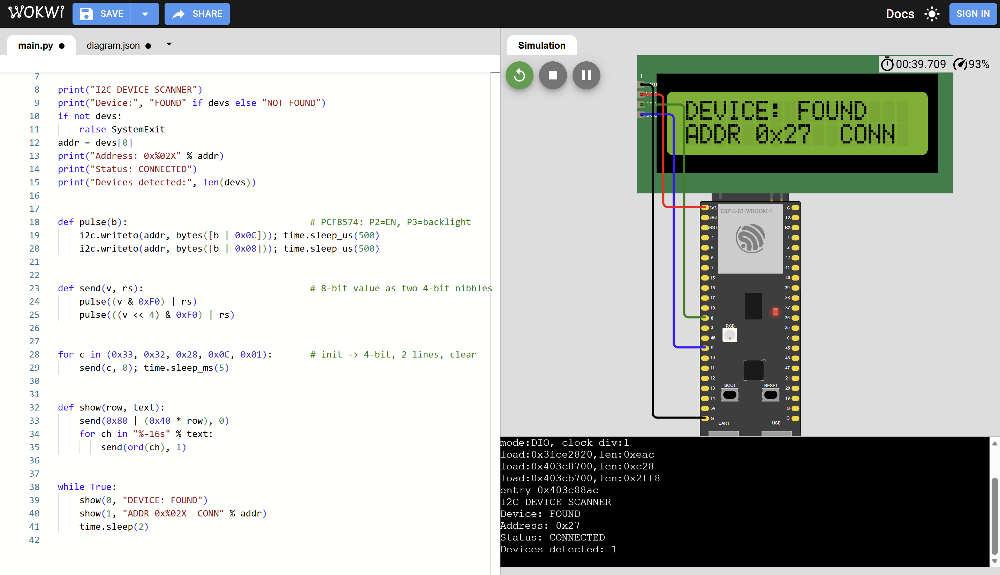
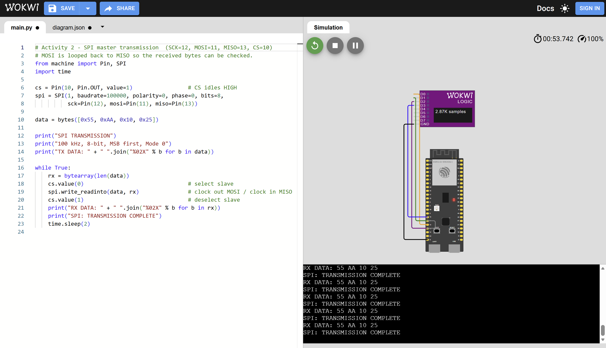
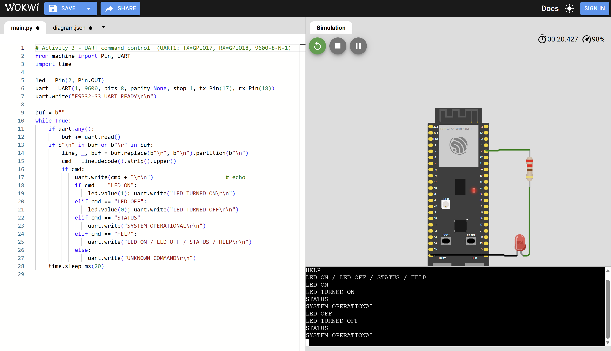

# I2C, SPI and UART Communication using ESP32-S3

Board: **ESP32-S3-DEVKITC-1**  |  Firmware: **MicroPython v1.28.0**  |  Simulator: **Wokwi**

Three in-class embedded-communication activities demonstrating the three most common
serial protocols on a single board, each with working code, a wired circuit, captured
serial/logic output and an observation table.

> **How to run:** open <https://wokwi.com/projects/new/micropython-esp32-s3>, paste the
> `diagram.json` and `main.py` from an activity folder, then press the green play button.

## Contents

| Activity | Protocol | Folder | Demonstrates |
|---|---|---|---|
| 1 | **I2C**  | [`Activity1-I2C`](Activity1-I2C)   | Bus scan + 16x2 LCD over a PCF8574 backpack |
| 2 | **SPI**  | [`Activity2-SPI`](Activity2-SPI)   | 4-byte master frame with MOSI->MISO loopback, logic analyser |
| 3 | **UART** | [`Activity3-UART`](Activity3-UART) | 9600-8-N-1 command console driving an LED |

Each folder contains `main.py` (MicroPython), `diagram.json` (Wokwi wiring),
`circuit.png` and `full-screenshot.png` (captured run).

---

## Activity 1 - I2C Device Scanner and LCD Display

**Connections:** SDA=GPIO8, SCL=GPIO9, 3V3, GND -> LCD1602 (PCF8574 backpack)



**Serial output**
```
I2C DEVICE SCANNER
Device: FOUND
Address: 0x27
Status: CONNECTED
Devices detected: 1
```

**Signal flow:** `i2c.scan()` sends a START, then every address 0x08-0x77 with the write
bit. A device that pulls SDA LOW on the 9th clock (ACK) is recorded - only 0x27 answered
(the PCF8574 on the LCD). Characters are then written to 0x27 as 4-bit nibbles
(P0=RS, P2=EN, P3=backlight, P4-P7=D4-D7).

## Activity 2 - SPI Data Transmission and Waveform Analysis

**Connections:** SCK=GPIO12, MOSI=GPIO11, MISO=GPIO13, CS=GPIO10 -> logic analyser; MOSI looped to MISO



**Serial output**
```
SPI TRANSMISSION
100 kHz, 8-bit, MSB first, Mode 0
TX DATA: 55 AA 10 25
RX DATA: 55 AA 10 25
SPI: TRANSMISSION COMPLETE
```

**Signal flow:** CS LOW selects the slave, the master generates SCK, and on each rising
edge (CPHA=0) the slave samples MOSI while the master samples MISO. After 32 edges CS
returns HIGH. SPI is full-duplex: one byte out and one byte in per 8 clocks.

## Activity 3 - UART Command-Based Control System

**Connections:** TX=GPIO17, RX=GPIO18 -> serial terminal; GPIO2 -> 220 ohm -> LED -> GND



**Terminal session**
```
ESP32-S3 UART READY
LED ON   -> LED TURNED ON
STATUS   -> SYSTEM OPERATIONAL
LED OFF  -> LED TURNED OFF
HELP     -> LED ON / LED OFF / STATUS / HELP
```

**Signal flow:** no shared clock - both ends agree on 9600-8-N-1. The receiver detects
the HIGH->LOW start-bit edge, waits half a bit time, then samples every 104.2 us. The
firmware buffers bytes until CR/LF, parses the line, and replies on TX.

---

## Protocol comparison

| Feature | I2C | SPI | UART |
|---|---|---|---|
| Communication type | Synchronous | Synchronous | Asynchronous |
| Clock | SCL (shared, master-driven) | SCK (master-driven) | None - agreed baud rate |
| Data wires | SDA (1, bidirectional, half-duplex) | MOSI + MISO (full-duplex) | TX + RX (full-duplex) |
| Minimum wires | 2 | 4 (3 + 1 CS per slave) | 2 |
| Device selection | 7-bit address on the bus | Chip Select line per slave | None - point-to-point |
| Speed (as used) | 100 kHz | 100 kHz (commonly tens of MHz) | 9600 baud |
| Typical use | Sensors, EEPROMs, LCD backpacks | Displays, flash, ADCs, SD cards | Debug consoles, GPS, modems |
| Error checking | ACK/NACK per byte | None built in | Optional parity bit |
| Measured here | 1 device at 0x27 | 32 SCK pulses per 4-byte frame | 104.2 us per bit |

**Why the trade-off exists:** I2C spends clock cycles on addressing and ACKs, so it is
slowest but needs only two wires for many devices. SPI drops addressing and error checking
for raw speed and full-duplex, at the cost of one extra pin per slave. UART removes the
clock wire entirely, which suits long point-to-point links, but both ends must agree on
timing in advance.

---

## Demonstration videos

Screen-record each Wokwi simulation (press play, capture the serial monitor / logic analyser /
LCD) and drop the files here, then link them below:

- **Activity 1 - I2C:** _add link_
- **Activity 2 - SPI:** _add link_
- **Activity 3 - UART:** _add link_

The captured still frames for each run are in every activity folder as `full-screenshot.png`.

A full write-up is in [`OBSERVATIONS-AND-REPORT.md`](OBSERVATIONS-AND-REPORT.md).
